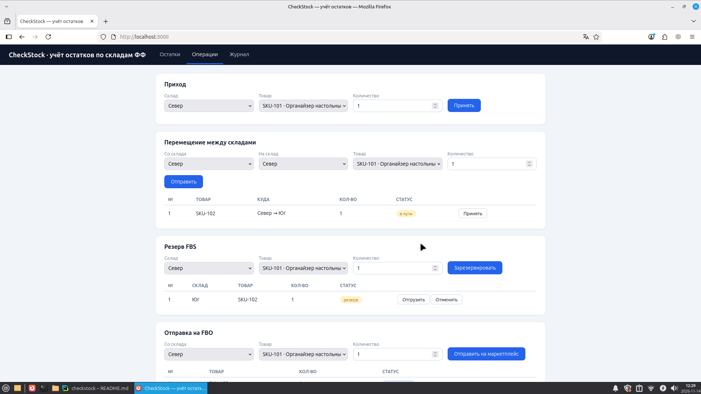

# CheckStock


Веб-приложение для учёта остатков на складе: товары (SKU), склады,
приход и расход, резервирования, отгрузки FBO и журнал операций.

## Развитие: переход на PostgreSQL(пока избыточно)

Проект построен так, что замена SQLite на PostgreSQL потребует минимальных
изменений:

- подключение к БД изолировано в одном модуле — достаточно заменить драйвер
  и строку подключения (например, на SQLAlchemy + asyncpg);
- добавить сервис `postgres` в `docker-compose.yml` (образ, volume, healthcheck)
  и передавать параметры подключения через переменные окружения;
- инициализацию схемы вынести в миграции (Alembic) вместо автосоздания при старте;
- для тестов в CI добавить контейнер-зависимость (services) в workflow.

Для текущих объёмов данных (локальный складской учёт) SQLite выбран
сознательно: нулевая настройка, файл в комплекте, полного покрытия
требований достаточно. При росте нагрузки — путь к PostgreSQL описан выше.

## Возможности

- учёт товаров (SKU) и остатков по складам;
- перемещения между складами;
- резервирования и отгрузки FBO;
- журнал операций с историей изменений;
- веб-интерфейс и интерактивная документация API (Swagger).

## API

API описывает полный операционный цикл склада: справочники, приёмка, перемещения, резервирования и отгрузки FBO, с журналом всех операций.

-    Справочники — товары и склады: просмотр и создание (GET/POST /api/skus, GET/POST /api/warehouses), удаление склада (DELETE /api/warehouses/{id}).
-    Остатки — текущие количества по товарам и складам (GET /api/stocks).
-    Приёмка — оприходование товара на склад (POST /api/receipts).
-    Перемещения — двухфазный цикл: создать перемещение между складами (POST /api/transfers), затем подтвердить приёмку на стороне получателя (POST /api/transfers/{id}/accept).
-    Резервирования — жизненный цикл заказа: создать резерв (POST /api/reservations), отгрузить (POST /api/reservations/{id}/ship) или отменить (POST /api/reservations/{id}/cancel).
-    FBO — создание и приёмка отгрузок маркетплейса (POST /api/fbo-shipments, POST /api/fbo-shipments/{id}/accept).
 -   Журнал — единый аудит всех операций (GET /api/journal).

Полный список методов с описаниями — на `/docs` после запуска.

## Запуск

```bash
git clone https://github.com/balynin76/checkstock.git
cd checkstock
docker compose up --build
```

После запуска:

- веб-интерфейс: <http://localhost:8000>
- Swagger UI: <http://localhost:8000/docs>

## Тесты

Dev-зависимости (pytest, ruff) не входят в прод-образ — устанавливаются
при запуске тестов:

```bash
docker compose run --rm app sh -c "pip install -r requirements-dev.txt && pytest"
```

## CI

Тесты и линтер запускаются автоматически на каждый push
через GitHub Actions (`.github/workflows/ci.yml`).

## Стек

- Python 3.12, FastAPI, Uvicorn
- SQLite(возможен быстрый переход на PostgreSQL)
- pytest, ruff
- Docker / docker compose
- GitHub Actions (CI)

## Скриншот


